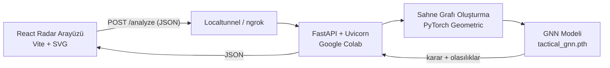

# 🚁 Cloud-Based Tactical Drone Mission Planner (GNN)


**Graph Neural Networks (GNN)** ile operasyon bölgesindeki nesneleri (Dron, Hedef, Sivil, Engel) analiz ederek taktiksel karar üreten bir simülasyon ve radar sistemi. Ağır model çıkarımı bulutta (Google Colab), arayüz ise yerelde hafif bir React istemcisi olarak çalışır.

> ⚠️ **Not:** Bu proje eğitim ve araştırma amaçlı bir simülasyondur. Gerçek bir operasyonel sistemde kullanılması amaçlanmamıştır.

<!-- 📸 Buraya radar arayüzünün ekran görüntüsü veya GIF'i ekle:

-->

---

## 📑 İçindekiler

- [Problem ve Motivasyon](#-problem-ve-motivasyon)
- [Öne Çıkan Özellikler](#-öne-çıkan-özellikler)
- [Mimari](#-mimari)
- [Model Detayları](#-model-detayları)
- [API Referansı](#-api-referansı)
- [Kurulum](#-kurulum)
- [Proje Yapısı](#-proje-yapısı)
- [Sınırlamalar](#-sınırlamalar)
- [Yol Haritası](#-yol-haritası)
- [Yazar](#-yazar)

---

## 🎯 Problem ve Motivasyon

Taktiksel bir sahnede karar vermek, nesnelerin tek tek değil **birbirleriyle ilişkisi** içinde değerlendirilmesini gerektirir: bir sivilin dronun yakınında olması, bir engelin hedefe giden yolu kapatması gibi. Klasik tablo tabanlı modeller bu ilişkileri doğal biçimde temsil edemez.

Bu projede sahne bir **graf** olarak modellenir: nesneler düğüm, aralarındaki mesafe ve tehdit ilişkileri kenar olur. GNN, bu yapı üzerinde mesaj geçirerek her nesnenin bağlamını öğrenir ve dron için en uygun aksiyonu seçer.

## 🌟 Öne Çıkan Özellikler

- **Sahne Grafı + GNN:** Nesneler düğüm, mesafe/tehdit ilişkileri kenar olarak işlenir; model bağlamı graf üzerinden öğrenir.
- **Edge-to-Cloud Hibrit Mimari:** PyTorch çıkarımı Colab'da, arayüz yerelde çalışır. Zayıf donanımlı cihazlarda bile kullanılabilir.
- **Gerçek Zamanlı Radar Arayüzü:** SVG tabanlı, sürükle-bırak ile nesne konumlandırma (X, Y).
- **Olasılıklı Karar Çıktısı:** *Yaklaş, Gözlemle, Kaçın* kararları sınıf olasılıklarıyla birlikte döner; modelin ne kadar emin olduğu görülebilir.
- **Asenkron API Akışı:** Arayüz bloklanmadan saniyeler içinde sonuç alır.

## 🏗️ Mimari



**Akış:**

1. **Frontend:** Kullanıcı radar üzerinde dron ve nesnelerin (X, Y) koordinatlarını yönetir.
2. **İstek:** "Taktiksel Analiz Yap" butonuyla sahne JSON olarak Cloud API'ye gönderilir.
3. **Graf oluşturma:** Backend, nesneleri düğüm, mesafe/tehdit ilişkilerini kenar olarak `Data` nesnesine dönüştürür.
4. **Çıkarım:** `tactical_gnn.pth` modeli grafı işler, her karar için olasılık üretir.
5. **Yanıt:** En yüksek olasılıklı karar ve tüm olasılık dağılımı arayüze döner.

## 🧠 Model Detayları

> Aşağıdaki değerleri kendi modeline göre güncelle.

| Özellik | Değer |
|---|---|
| Düğüm tipleri | Dron, Hedef, Sivil, Engel |
| Düğüm özellikleri | `[...]` (ör. tip one-hot, x, y) |
| Kenar özellikleri | `[...]` (ör. öklid mesafesi, tehdit skoru) |
| Mimari | `[...]` (ör. 2× GCNConv/GATConv + global pooling + Linear) |
| Çıktı sınıfları | Yaklaş, Gözlemle, Kaçın |
| Eğitim verisi | `[...]` (sentetik / kural tabanlı etiketli sahneler, N örnek) |
| Doğruluk | `[...]` (test seti) |

## 📡 API Referansı

### `POST /analyze`

**İstek örneği**

```json
{
  "nodes": [
    { "id": 0, "type": "drone",    "x": 120, "y": 340 },
    { "id": 1, "type": "target",   "x": 410, "y": 150 },
    { "id": 2, "type": "civilian", "x": 380, "y": 190 },
    { "id": 3, "type": "obstacle", "x": 250, "y": 260 }
  ]
}
```

**Yanıt örneği**

```json
{
  "decision": "Gözlemle",
  "probabilities": {
    "Yaklaş": 0.18,
    "Gözlemle": 0.71,
    "Kaçın": 0.11
  }
}
```

> Endpoint adı ve alanlar örnektir; kendi API'ne göre düzenle.

## ⚙️ Kurulum

### 1) Backend (Google Colab)

```python
!pip install torch torch_geometric fastapi uvicorn nest_asyncio pyngrok
```

1. `notebooks/backend.ipynb` dosyasını Colab'da aç.
2. `tactical_gnn.pth` dosyasını Colab ortamına yükle.
3. Hücreleri çalıştır; çıktıda görünen **public tünel URL'sini** kopyala.

### 2) Frontend (yerel)

```bash
git clone https://github.com/nlmehmet/<repo-adı>.git
cd <repo-adı>/frontend
npm install
```

`.env` dosyası oluştur:

```env
VITE_API_URL=https://<tunel-adresin>
```

Çalıştır:

```bash
npm run dev
```

Tarayıcıda `http://localhost:5173` adresini aç.

## 📂 Proje Yapısı

```text
.
├── backend/
│   ├── main.py            # FastAPI uygulaması
│   ├── model.py           # GNN mimarisi
│   ├── graph_builder.py   # JSON -> sahne grafı
│   └── tactical_gnn.pth   # Eğitilmiş ağırlıklar
├── frontend/
│   ├── src/
│   │   ├── components/Radar.jsx
│   │   └── App.jsx
│   └── vite.config.js
├── notebooks/             # Eğitim ve Colab çalıştırma defterleri
└── README.md
```

> Gerçek klasör yapına göre düzenle.

## ⚠️ Sınırlamalar

- Colab oturumu kapandığında API ve tünel adresi değişir; sürekli çalışan bir servis değildir.
- Model, sentetik/etiketlenmiş sahnelerle eğitilmiştir; gerçek dünya verisiyle doğrulanmamıştır.
- Tünel adresi herkese açıktır; kimlik doğrulama yoktur.

## 🗺️ Yol Haritası

- [ ] Eğitim notebook'unu ve veri üretim betiğini repoya ekle
- [ ] Model metrikleri (confusion matrix, doğruluk) ekle
- [ ] Docker ile tek komutla çalıştırma
- [ ] Kalıcı barındırma (Hugging Face Spaces / Render / Cloud Run)
- [ ] API'ye anahtar tabanlı kimlik doğrulama
- [ ] Daha fazla nesne tipi ve hareketli hedef desteği
- [ ] Karar açıklanabilirliği (GNNExplainer ile hangi kenar kararı etkiledi?)

## 👤 Yazar

**Mehmet Önal** · [GitHub](https://github.com/nlmehmet)

---

⭐ Projeyi beğendiysen yıldız vermeyi unutma!
